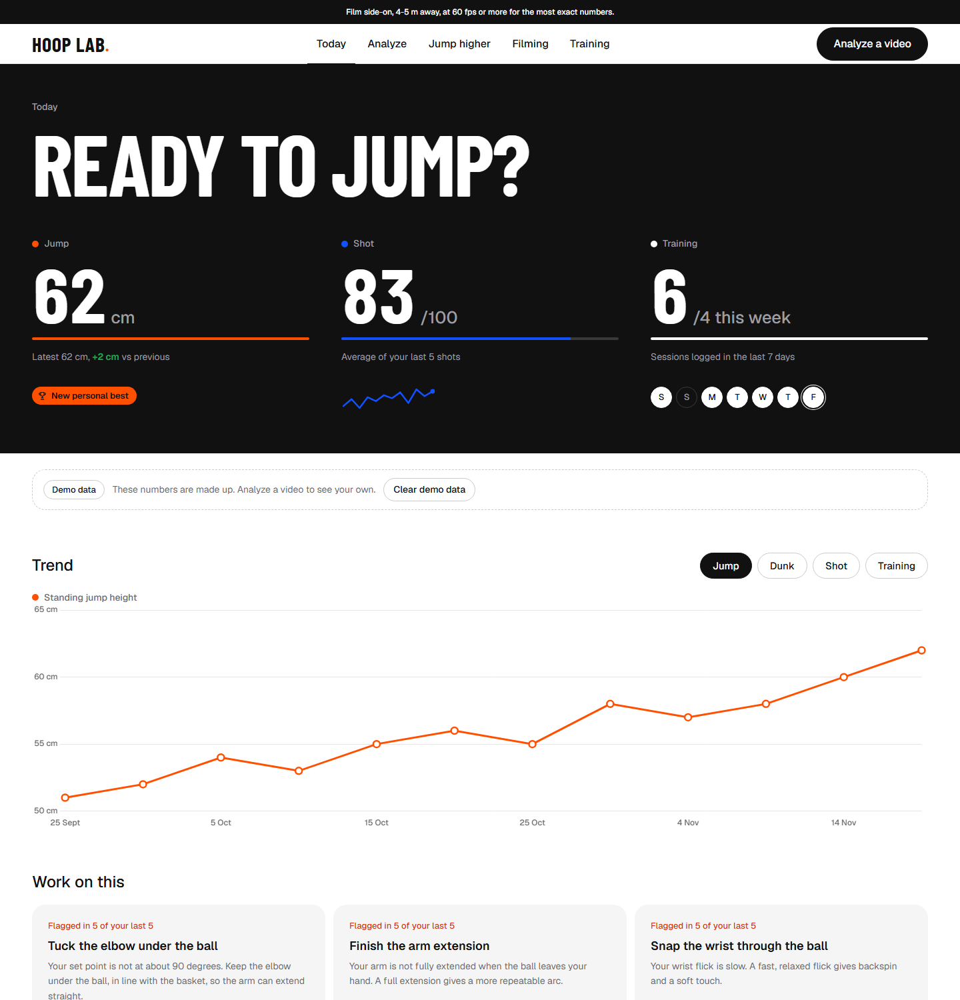
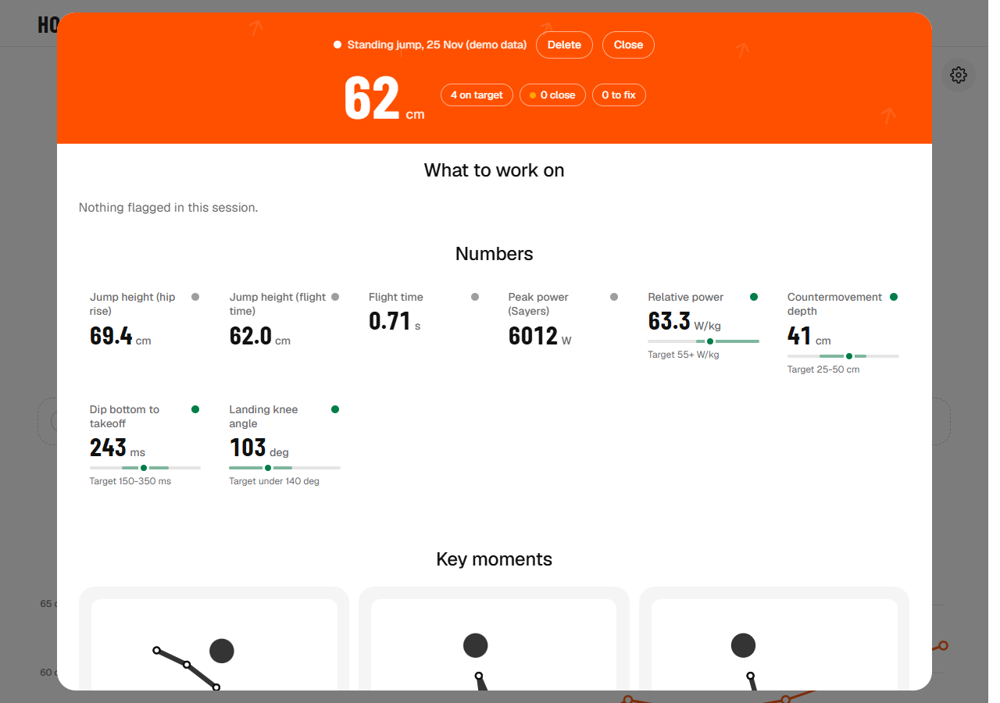
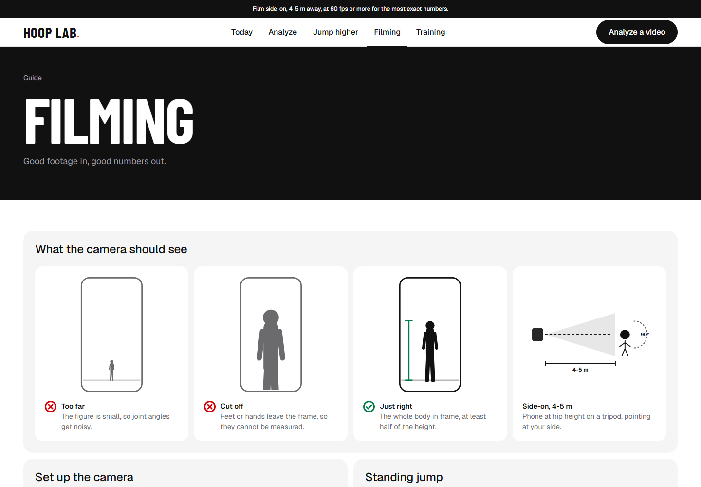

<p align="center">
  
</p>

<h1 align="center">Hoop Lab</h1>

<p align="center">
  <b>Film your jump or your shot. Get the numbers and what to fix.</b><br>
  Body tracking in your browser measures jump height, dip, landing and shooting form from a phone video, then turns
  every flagged number into drills and tracks your progress. Your videos never leave your device.
</p>

<p align="center">
  <b><a href="https://lexvanwalsem.github.io/hoop-lab/">Open the app</a></b> (add it to your home screen on iPhone or Android)
</p>

<p align="center">
  <a href="https://github.com/lexvanwalsem/hoop-lab/actions/workflows/test.yml"></a>
  
  
  
</p>

<p align="center">
  
</p>

<p align="center"><sub>Screenshots show the built-in demo data (<code>?demo</code>), not real people.</sub></p>

## The problem

Everyone says "jump higher" and "fix your shooting form", and almost nobody measures it. Measuring needs a force plate, a
Vertec, a coach with a high-speed camera or an app that uploads your videos to a server. Your phone already films at 60
fps. What is missing is the part that turns that video into numbers you can trust and a list of what to work on.

## What Hoop Lab does

Pick the type of test, drop in a video and fill in your real height and weight. Hoop Lab steps through the video,
finds your joints in every frame, finds each jump or shot in the clip and measures it.

- **Standing jump and dunk approach jump:** jump height, flight time, countermovement depth, dip bottom to takeoff,
  landing knee angle, an estimated relative power and, for the dunk, approach speed and reach above the rim.
- **Jump shot:** a form score and the numbers behind it: knee bend, elbow at set point and at release, release height
  and angle, set point to release time, wrist flick, follow-through, how the release lines up with the top of your jump,
  and forward drift. The ball is tracked, so the launch angle is measured and not guessed.
- **Where it went wrong:** the key moments of every jump or shot (dip, takeoff, landing; set point, release) are drawn as the
  tracked body with the joint angles on it. A wedge shows each angle, flagged angles are coloured and show their target,
  and the card is outlined when it needs work. They are saved with the session as small drawings (about 2 KB), not as
  video or photos, so they contain no faces and can be opened again later.
- **Replay:** the tracked skeleton of every jump or shot, with a timeline you can step through by phase.
- **Advice:** every metric that is flagged comes with a plain explanation and concrete drills, with sets and reps. Each
  drill has a Watch link that opens a video search for how to do it, only when you click it.
- **Progress:** a dashboard with your jump trend, shot score, personal bests, the habits that keep coming back, and an
  exercise log.
- **Framing check:** a live camera view that tracks your body and tells you what to fix before you film: whole body in
  frame, big enough with room to jump, side-on, enough light. Nothing is recorded; you then film with your camera app.
- **Built for the phone:** lists of cards become swipeable rows with dots, guide sections fold open one at a time, and long
  tables show the latest rows first, so there is no endless scrolling.
- **Guides:** how to film so the numbers are good, and how to jump higher (technique, training, a simple week).

<p align="center">
  
</p>

## How it is different

| | Hoop Lab | A coach with a camera | Slow-motion app | Force plate or jump mat |
|---|---|---|---|---|
| Cost | Free | Expensive | Free to cheap | Expensive |
| Works from one phone video | Yes | Yes | Yes | No |
| Measures instead of eyeballing | Yes | Partly | No, you step through it yourself | Yes |
| Shooting form and jump in one tool | Yes | Yes | No | No |
| Tells you what to work on | Yes | Yes | No | No |
| Videos stay on your device | Yes | Depends | Depends | Yes |
| Exact to the millimetre | No, about 3 to 5 cm | No | No | Yes |

Hoop Lab does not replace a force plate. It gives you a consistent, free measurement you can repeat every week.

## Why use it

| You want to | Hoop Lab gives you |
|---|---|
| Know your real vertical | Flight-time jump height, with the hip rise next to it as a second opinion |
| See if training works | A trend line with a goal and personal bests, built from the same camera spot every time |
| Fix your shot | A score plus the exact joint angles and timings that are off, and drills for each |
| Film it right the first time | A filming guide with the distance, angle, frame rate and phone settings |
| Keep your videos private | Everything runs locally, nothing is uploaded |

## Good for

- Players who train alone and have no coach to measure them
- Coaches who want repeatable numbers for a group, from phone videos
- Anyone tracking a vertical jump goal over months
- Parents and trainers who want to see form changes without sending children's videos to a server

## Install and use

You need Node.js 22.18 or newer.

```powershell
npm install   # first time only: copies the WASM runtime and downloads the tracking models (about 50 MB)
npm run dev   # then open http://localhost:5173
```

On Windows you can also double-click `start.cmd`. It installs on first run, opens the browser and starts the app.

1. Open **Analyze** and enter your real height and weight. They set the scale and the power estimate, so wrong values
   give wrong numbers. There are no default values on purpose.
2. Choose the test, choose or drop a video, press **Analyze**. The frame rate is read from the file. Clips at 120 or 240
   fps are analyzed at 60, or an exact divisor of it, to keep tracking fast.
3. Keep the tab open until it finishes. The analysis keeps running if you switch tabs inside the app. Expect about 1.5
   minutes for a 15 second jump clip and about 4 minutes for a 20 second shot clip (the shot also tracks the ball).
4. The result is saved to the dashboard. Open any session later from the list.

To try the app before you have a video, open `http://localhost:5173/?demo`. It loads clearly labelled sample data that
you can remove in one click.

From a phone on the same wifi: `npm run dev` prints a Network URL. Open it on the phone and choose a video. Results live
in the browser you used, so phone and PC keep separate dashboards. Use **Your data** on the dashboard to export a backup
and import it somewhere else.

<p align="center">
  
</p>

## On your phone

Hoop Lab is a progressive web app (PWA): you open it once from a web address and install it on the home screen. The
tracking runs on the phone itself, there is no server doing the work.

**Hosting.** A GitHub Pages workflow (`.github/workflows/pages.yml`) builds the app, including the tracking models, and
publishes it on every push to `main`. GitHub Pages needs a public repository, so the workflow does nothing while the
repository is private. To turn it on after making the repository public: Settings, Pages, Source: GitHub Actions. The
address is `https://lexvanwalsem.github.io/hoop-lab/`. Any other static host with HTTPS works as well: upload the
`dist` folder after `npm run build`.

**Installing.**
1. Open the address on the phone. iPhone: Safari, Share, Add to Home Screen. Android: Chrome, Install app.
2. After the first start the app and its models are cached, so it also works offline.

HTTPS is required for installing and for the camera in the framing check. A plain `http://` address on your wifi still
works for analyzing videos, just not for installing. Results live in the browser or app you used: use **Your data** on
the dashboard to move a backup between devices: on a phone the export opens the share sheet, so you can save the file
to Files, iCloud or Drive, or mail it to yourself. Import picks the file again from there. Speed depends on the phone, and tracking is slower on older ones.

## Filming in short

- Phone on a tripod or something solid. It must not move.
- Side-on, 4 to 5 m away, camera at hip height, whole body in frame, feet to fingertips, including the top of the jump.
  Fill at least half of the frame height with your body.
- 60 fps or more (slow-motion at 120 or 240 fps is fine). On iPhone: Settings, Camera, Record Video, 1080p HD at 60 fps.
- Stand still for 2 seconds at the start. Good light, a plain background, fitted clothes, shoes visible.
- Use the same camera spot every time so results are comparable.

The in-app **Filming** page has the full version with diagrams.

## How it works

1. **Pose tracking.** MediaPipe Pose (the heavy model) finds 33 body landmarks in every frame, in the browser through
   WebAssembly. For shots, an object detector looks for the ball in each frame.
2. **Calibration.** The scale in centimetres per pixel comes from your height: the nose-to-ankle span is about 89 % of
   your height, measured while you stand upright in the 4 seconds before takeoff. Wrong height means wrong scale.
3. **Jump height.** The standing jump height comes from flight time, `h = g * T^2 / 8`, where `T` is the time between
   takeoff and landing. It needs no scale at all, which makes it the most reliable number. The rise of the hips is shown
   next to it. Relative power uses the Sayers formula, `60.7 * jump height + 45.3 * body mass - 2055`, and is an
   estimate for comparing yourself over time, not an exact measure.
4. **Shots.** A shot is the shooting wrist above the nose with the elbow extending, and shots less than 2 seconds apart
   count as one. The release is the first frame where the ball is clearly away from the hand. Joint angles use the 3D
   landmarks, so a slightly diagonal camera still works.
5. **Advice.** `src/coach.ts` maps every flagged metric to an explanation and drills, and tells too low from too high.

## Built to be trusted

- **Videos never leave your device.** There is no server, no upload and no account.
- **Only links leave the app.** The Watch links open a YouTube search, and only when you click them.
- **Models run locally.** The tracking models and the WebAssembly runtime are served from the app (`public/`), not a CDN.
- **Data stays in your browser** (`localStorage`). You can export and import a backup file, and delete everything. The app
  shows when you last made a backup and reminds you after a month, because a browser can clear its storage.
- **Honest numbers.** Targets in the app are starting points, the accuracy is stated below, and demo data is always
  labelled.
- **Tests.** `npm test` checks the calibration, jump and shot detection on synthetic stick-figure clips with known
  answers, and the storage, backup, advice and video header logic.

## Limits

- Accuracy is roughly 3 to 5 cm for the jump. The same video can differ a few centimetres between runs, because stepping
  through a video does not land on exactly the same frames every time.
- At 30 fps the jump height is fine, but takeoff and landing timing and shot timing are coarse (33 ms per frame).
- A figure that is small in the frame makes joint angles noisy. A front view is less accurate than a side view for joint
  angles.
- Ball detection uses a generic "sports ball" model. A ball hidden in the hand or blurred is often missed. When it is
  not found, the release is estimated from the elbow.
- Make or miss is out of scope. Hoop Lab is about form, not outcome.
- Some iPhone videos are HEVC (H.265) and not every browser can decode them. Use Safari or Edge, or convert the video to
  H.264.
- Tracking takes minutes, and a browser can slow down background tabs. Keep the analysis tab visible.
- Metric thresholds in `src/analysis.ts` are starting points. Tune them to your own good reps.
- This is general training information, not medical advice. Stop if you feel pain.

## What is next

- Compare two sessions side by side
- Draw the tracked skeleton on top of your original video
- A free-throw and layup mode
- A lighter tracking model as an option for older phones
- Animated demos of the drills, drawn with the same skeleton as the jump guide, instead of a video search
- Saving the full skeleton track in IndexedDB, so the replay of an old session works after a restart

## Development

```powershell
npm test         # unit and synthetic tests
npm run build    # type check and production build into dist/
```

| File | What it does |
|---|---|
| `src/pose.ts` | Steps through a video and runs pose and ball detection |
| `src/snapshots.ts`, `src/snapview.ts` | Key moments: the body points and joint angles of a frame, and how they are drawn |
| `src/camera.ts`, `src/framing.ts` | The live framing check and its pure rules |
| `src/video.ts` | Reads the frame rate from the MP4 or MOV header, probes the video |
| `src/analysis.ts` | Calibration, jump and shot detection, metrics |
| `src/coach.ts` | Advice and drills per flagged metric |
| `src/guide.ts` | Content of the Jump higher and Filming pages |
| `src/store.ts` | Storage, validation, backup and import |
| `src/demo.ts` | Sample data for `?demo` |
| `src/charts.ts`, `src/gauge.ts`, `src/art.ts` | Charts, range gauges, icons and illustrations |
| `src/main.ts`, `src/style.css` | The interface |
| `public/sw.js`, `public/manifest.webmanifest` | Offline support and install on a phone |
| `tests/` | Synthetic clips and unit tests |

The visual rules are in [DESIGN.md](DESIGN.md) and the licenses of what Hoop Lab builds on are in
[THIRD_PARTY.md](THIRD_PARTY.md).

## Contributing

Pull requests are welcome. Read [CONTRIBUTING.md](CONTRIBUTING.md) first. Security problems: see
[SECURITY.md](SECURITY.md).

## License

[MIT](LICENSE)
